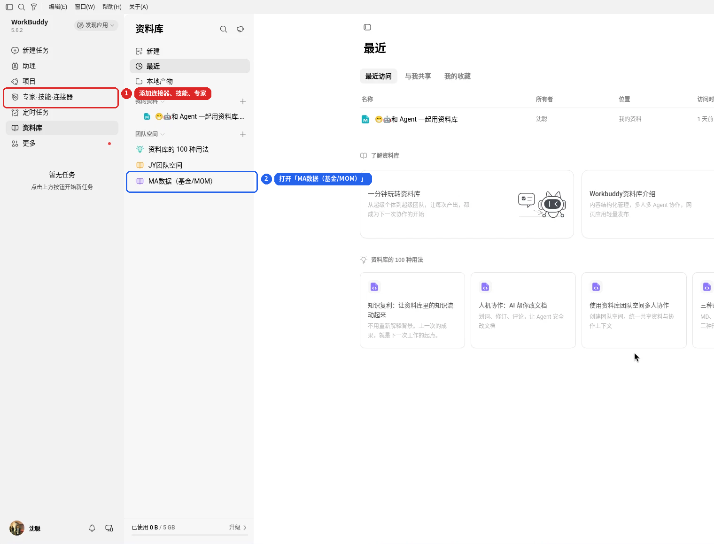
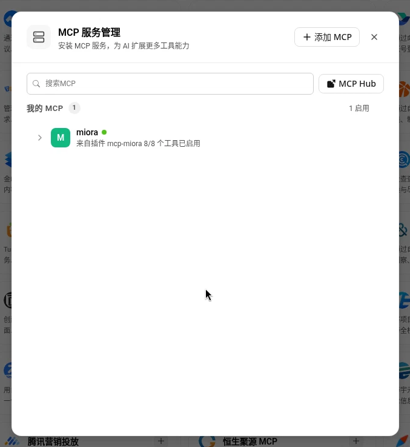
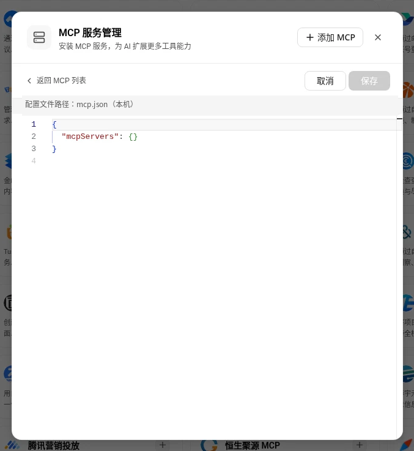
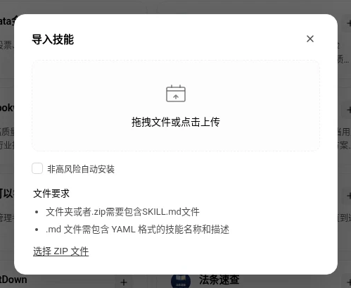
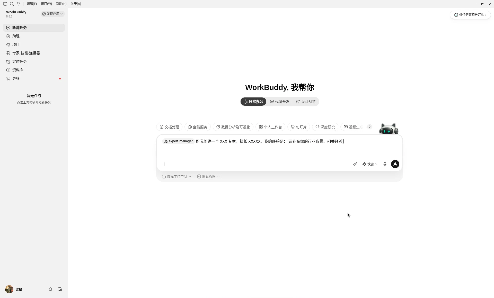

# 在 WorkBuddy 中使用 MA 基金数据 / MOM 数据

本目录提供两个 MCP 连接器的说明、可上传的技能包和专家包。把这些内容放进 WorkBuddy 的团队空间后，同事可以按自己的 MA 系统账号使用同一套数据能力。

**权限原则：** WorkBuddy 里的每一次 API / MCP 调用，都必须落在调用者自己的 MA 账户上，可见范围与该账户在网站上的页面权限相同。不要把任何人的 API Key 写进技能、专家或团队空间。首次使用时，连接器应弹出登录/授权卡片，用自己的网站账号登录。

这些文件只是本地包装，不会自动出现在 WorkBuddy 里。请按下面的步骤添加连接器并导入技能和专家。不必、也不应在别人的电脑上代替操作。

## 1. 团队空间「MA数据（基金/MOM）」

普通同事不必自己新建团队空间。加入由管理员邀请的「MA数据（基金/MOM）」后，在资料库中打开该空间即可。不要把本系统的连接器、技能和专家放进「JY团队空间」。



1. 打开 WorkBuddy，进入左侧「资料库」。
2. 在「团队空间」中打开「MA数据（基金/MOM）」。
3. 在左侧「专家·技能·连接器」中添加连接器，并导入技能和专家。这个空间里的说明和打包文件也可以一并查阅。

管理员邀请同事：

1. 打开「MA数据（基金/MOM）」空间。
2. 点击空间菜单，选择 **邀请和管理成员**。
3. 用复制链接、二维码或微信邀请加入。
4. 按角色设置权限：查看、编辑、管理。空间默认不对外公开。

被邀请的人加入空间后，仍须各自完成下面的连接器授权。空间只共享说明和技能/专家包，不共享任何人的登录态或 API Key。

## 2. 添加两个自定义连接器

基金数据和 MOM 数据是两个 MCP，也是两套凭证，请各建一个连接器。推荐使用 **MCP OAuth 2.1**（只需填写 MCP 地址，首次使用跳转到本系统登录页）。

生产环境默认文档地址仍是 HTTP：`http://8.154.33.143`。同一台服务器同时提供 HTTPS：`https://8.154.33.143`（Let's Encrypt 证书）。在 WorkBuddy 中必须填写 HTTPS 地址。HTTP 会被 nginx 301 转到 HTTPS，Streamable HTTP 客户端会把初始化 POST 改成 GET，然后把返回的说明 JSON 当成 JSON-RPC 校验，连接直接失败。

| 连接器显示名称 | MCP Server URL |
| --- | --- |
| MA 基金数据 | `https://8.154.33.143/ma/api/fund-data/mcp` |
| MA MOM数据 | `https://8.154.33.143/ma/api/mom-data/mcp` |

步骤：

1. 左侧边栏打开 **专家·技能·连接器**，选中 **连接器** 页签。
2. 点击右上角 **自定义连接器**。
3. 若出现带认证方式的表单：填写显示名称（上表），认证方式选择 **MCP OAuth 2.1**，不必填 Client ID 或 Secret。MCP Server URL 填写上表对应地址，Transport 选择 **http（Streamable HTTP，默认）**，不要选 SSE，然后保存。
4. 若打开的是「MCP 服务管理」（WorkBuddy 5.6.2 常见），点击 **+ 添加 MCP**，把两个 MCP 按客户端格式写进本机 `mcp.json` 的 `mcpServers`，URL 用上表 HTTPS 地址。不要把 API Key 写进这份配置或团队空间。保存后仍须用自己的账号完成授权。
5. 对第二个 API 再重复一遍，得到两个连接器。
6. 在连接器卡片上点击 **+** 连接，或在对话需要用到时点击输入框上方的连接引导卡片。
7. 浏览器打开本系统的登录/授权页后，用 **自己的** 网站账号（邮箱或用户名 + 密码）登录，再点击「允许授权」。
8. 回到 WorkBuddy，卡片出现绿色圆点即表示已用当前账号连上。





每个同事都要自己走一遍第 6–8 步。你连上了，并不等于同事也连上了，更不会让同事继承你的权限。

若 OAuth 暂时不可用，可改用 API Key：Header 名保持 `X-API-Key`，打开「作为 MCP Server」，每个用户到本系统「用户中心」（基金）或「设置 → MOM数据API」（MOM）复制 **自己的** Key。基金 Key（`mf_` 开头）不能用于 MOM 连接器，MOM Key（`mk_` 开头）不能用于基金连接器。

OAuth 发现地址（通常不必手填）：

- 授权：`https://8.154.33.143/oauth/authorize`
- 令牌：`https://8.154.33.143/oauth/token`
- 动态注册：`https://8.154.33.143/oauth/register`
- 授权服务器元数据：`https://8.154.33.143/.well-known/oauth-authorization-server`

上述地址在部署本仓库的 MCP OAuth 改动并重启应用之后才会生效。

## 3. 导入技能

技能 zip 在 `docs/workbuddy/skills/*.zip`。每个 zip 解压后是一个根目录，目录内直接是 `SKILL.md`。

1. 左侧边栏打开 **专家·技能·连接器**，选中 **技能** 页签。
2. 点击 **添加技能** → **上传技能**。
3. 拖入或选择对应的 zip，等待自动导入。
4. 在「已安装」中确认技能已启用。只启用当前要用的技能即可。



建议先导入这五个：

| 技能包 | 用途 | 依赖的连接器 |
| --- | --- | --- |
| `ma-fund-nav.zip` | 基金查询与净值 | MA 基金数据 |
| `ma-tracking-managed.zip` | 跟踪池与在管产品 | MA 基金数据（需相应页面权限） |
| `ma-ai-researcher.zip` | AI 研究员对比、相似/相反、路演扫描等 | MA 基金数据（需 AI 研究员权限） |
| `ma-kb-qa.zip` | 知识库问答与原文核验 | MA 基金数据（需 AI 知识库权限） |
| `ma-mom-accounts.zip` | MOM 账户、持仓、核算与风险指标 | MA MOM数据（需开通 MOM数据API） |

源文件在 `docs/workbuddy/skills/<技能名>/`。

## 4. 导入或创建专家

专家提示词包在 `docs/workbuddy/experts/`。有两种用法：

**方式 A：在「我的专家」里创建（适合先试用）**

1. 打开 **专家·技能·连接器** → 专家页签 → 右上角 **我的专家**。
2. 在「我的专家」中点击 **+ 创建专家**。名称创建后不能改，请一次起好，例如「私募基金研究员」「MOM盘手分析助手」。
3. 在 WorkBuddy 5.6.2 里，这一步会打开「新建任务」并预填 `@expert-manager` 提示词，按提示创建即可。若客户端提供名称和提示词表单，把对应目录里 `agents/*.md` 的正文（人设、工作流程、输出规范、登录规则）粘贴到提示词里。
4. 擅长领域和建议提示词可参考同目录 `README.md` 或 `.codebuddy-plugin/plugin.json` 里的 `tags`、`quickPrompts`。
5. 创建后先用一条真实问题试召唤，再分享给同事，或把专家放到团队空间供以后使用。



**方式 B：导入专家包 zip（若客户端支持）**

企业控制台可在「AI 资源管理 → 专家管理」上传 `.zip` 专家包；个人客户端若提供导入入口，选择 `docs/workbuddy/experts/*.zip`。包结构为：

```
pe-fund-researcher/
  .codebuddy-plugin/plugin.json
  agents/pe-fund-researcher.md
  README.md
```

专家本身不会登录本系统。它们依赖上面的连接器和技能。若连接器未授权，专家应停下来请用户用自己的账号连接，而不是编造数据或改用他人的 Key。

建议先创建/导入：

- 私募基金研究员：基金查询、对比、跟踪池、知识库观点核验
- MOM盘手分析助手：账户筛选、每日核算、持仓成交、历史风险指标

## 5. 权限对照

| 能力 | 网站权限 | 未开通时的表现 |
| --- | --- | --- |
| 基金公开查询（搜索、资料、净值、协会信息等） | 有效的基金数据身份（OAuth 或自己的基金 API Key） | 401 |
| 跟踪池 | 可进入投资页 | 工具不出现在 tools/list，直接调用被拒绝 |
| 在管产品 | 投资池权限 | 同上 |
| AI 研究员 | AI 研究员权限 | 同上 |
| 知识库问答 | AI 知识库权限 | 同上 |
| MOM 账户 / 持仓 / 指标 | 开通「MOM数据API」 | 连接或调用返回 403 |

管理员账号默认拥有以上全部能力。普通账号以管理员在用户管理里勾选的页面权限为准。

## 6. 本地与上线

本目录和网站文档、OAuth 登录页的代码目前只在本地仓库。要让 WorkBuddy 的 OAuth 跳转在生产环境生效，需要在 17:00（Asia/Shanghai）之后部署并重启应用。技能和专家包可以先在本地准备，部署完成后再让同事连接 HTTPS MCP 地址。
